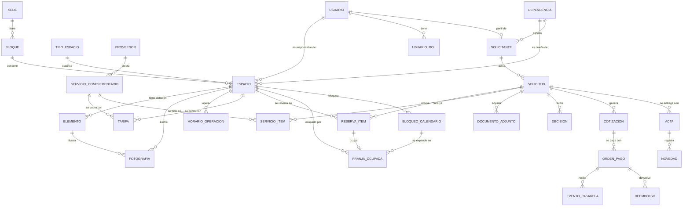
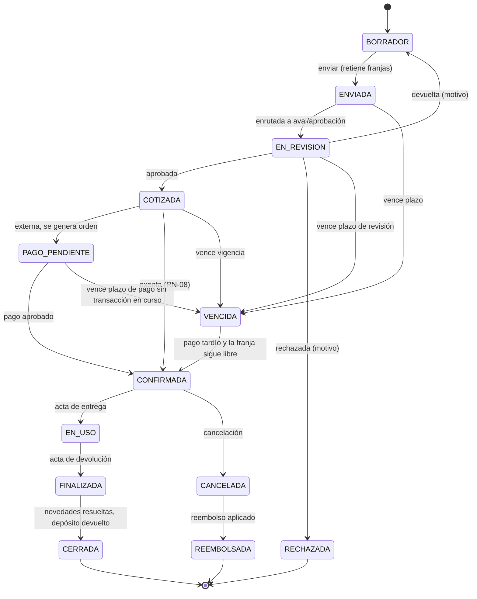

# SIRA - Modelo de datos

> **Fuente de verdad:** el esquema Prisma completo está en `anexos/schema.prisma` y se copia tal cual a `prisma/schema.prisma` (raíz del repositorio Backend) al inicializar el proyecto (ver `09`). Este documento explica el *porqué*; el esquema dice el *qué*. Si se contradicen, gana el esquema y se corrige este documento en el mismo PR.
> Restricciones que Prisma no puede expresar: `anexos/restricciones.sql` → se copia a `prisma/sql/restricciones.sql`. Ya fue probado contra PostgreSQL 16: rechaza solapamientos, permite franjas contiguas, y en una prueba de carrera de dos transacciones simultáneas solo una confirma.

## 1. Decisiones transversales

| Tema | Decisión | Razón |
|---|---|---|
| Identificadores | UUID v4 en todas las tablas, salvo `bitacora` (BigInt autoincremental). | Los UUID no revelan cuántos registros hay ni permiten adivinar URLs. La bitácora necesita orden estricto. |
| Consecutivos visibles | `SOL-2026-0001`, `COT-2026-0001`, `OP-2026-000001`, `ACT-2026-0001`, generados desde la tabla `consecutivo` con `UPDATE … RETURNING` dentro de la transacción. | RN-17: únicos, secuenciales y nunca reutilizados, aunque se anule el documento. Una secuencia de PostgreSQL deja huecos cuando una transacción hace rollback; con la tabla, el número se consume solo si la transacción confirma. |
| Dinero | **Pesos enteros (`Int`)**. La conversión a centavos ocurre únicamente en el adaptador de la pasarela. ⚠️ Cambio respecto al doc (ver `07`). | COP no maneja decimales (RNF-13) y `Int` alcanza hasta 2.147 millones por registro. Evita `BigInt`, que JSON no serializa. |
| Porcentajes | `Decimal(5,2)`. | Nunca `Float`. |
| Fechas | `timestamptz` en UTC. La UI convierte a `America/Bogota`. Fechas sin hora (vigencias, festivos) en `date`. | Colombia no tiene horario de verano, pero guardar en UTC evita errores al comparar con la pasarela y con los servidores. |
| Borrado | **Nada se borra físicamente.** Espacios con `archivadoEn`, solicitudes con estado, bloqueos con `anuladoEn`, franjas con estado `LIBERADA`. | El histórico de reservas, pagos y actas tiene valor fiscal y de auditoría. |
| Auditoría de cambios | `creadoEn` y `actualizadoEn` en todas las tablas operativas; la bitácora guarda quién, antes y después. | RF-AUD-01. |
| Archivos | Fuera de la BD, en almacenamiento S3 compatible (MinIO en desarrollo). En la BD solo URLs. | Fotos, actas, soportes y PDF. |
| Datos sensibles | Nunca datos de tarjeta (RNF-07). Contraseñas con Argon2id. Tokens de refresco y códigos de verificación se guardan **hasheados**. Documento de identidad en claro con anonimización al vencer la retención (RNF-08). ⚠️ Cifrado en reposo a nivel de disco/volumen, no por columna, en la v1. | |

## 2. Diagrama entidad-relación



## 3. Entidades por contexto

### 3.1 Identidad y acceso

| Entidad | Para qué | Campos clave |
|---|---|---|
| `Usuario` | Cuenta de acceso. | `correo` (único), `hashContrasena` (Argon2id), `correoVerificado`, `esInstitucional`, `intentosFallidos`, `bloqueadoHasta`, `mfaSecreto`. |
| `UsuarioRol` | Roles del usuario, con alcance opcional por dependencia. | `rol`, `dependenciaId`. Un aprobador de "Bienestar" solo ve solicitudes de espacios de Bienestar. |
| `Solicitante` | Perfil de quien pide (1:1 con usuario). | `tipo`, documento (único por tipo + número), razón social, representante legal, dependencia (internos). |
| `Dependencia` | Dependencia, programa o proceso. Dueña de espacios y centro de costo. | `codigo`, `jefeId` (aprobador por defecto), `centroCosto`. |
| `SesionRefresh` | Tokens de refresco rotativos (RF-AUT-01). | `hashToken`, `familia` (si se reusa un token viejo se revoca toda la familia). |
| `CodigoVerificacion` | Código de 6 dígitos del correo (15 min) y enlace de recuperación (30 min). | `proposito`, `hashCodigo`, `expiraEn`, `intentos`. |
| `ConsentimientoDatos` | Ley 1581 (RF-AUT-08). | `versionPolitica`, `ip`, `aceptadoEn`. |

**Roles y quién aprueba.** El rol `RESPONSABLE_ESPACIO` no se asigna con `UsuarioRol` sino con `Espacio.responsableId` (es por espacio). El aprobador de una solicitud es el `jefeId` de la dependencia dueña del espacio, o un usuario con rol `APROBADOR` y alcance en esa dependencia. ⚠️ Pendiente confirmar el papel exacto de la Vicerrectoría (ver `07`).

### 3.2 Inventario

| Entidad | Para qué | Campos clave |
|---|---|---|
| `Sede` | Mocoa (principal), Sibundoy, extensiones. | `codigo`, `municipio`, `orden`. |
| `Bloque` | **Eje de navegación del portal.** Bloque A, B, C. | `codigo`, `planoUrl` (plano con la numeración oficial), `numeroPisos`, `orden`. |
| `TipoEspacio` | Aula, laboratorio, sala de informática, auditorio, escenario deportivo... Editable por el administrador (RF-INV-03). | `anticipacionMinimaDias`, `anticipacionEnHabiles`, `aforoExigePoliza`. |
| `Espacio` | **Unidad reservable.** | `codigo` = numeración del plano (ej. `A-201`), `piso`, `capacidadPersonas`, `minutosMontaje`, `minutosDesmontaje`, depósito, `estado`, `requiereAval`. |
| `HorarioOperacion` | Franja de operación por día (RF-CAL-03). | `diaSemana`, `abre`, `cierra`. Si un espacio no tiene filas, aplica 06:00–22:00. |
| `Elemento` | Dotación con placa, valor y estado. | `placaInventario` (única), `cantidad`, `estadoFisico`, `estado`, `valorUnitario`, `esPrestable`. |
| `HistorialEstadoElemento` | RF-INV-12. | |
| `Fotografia` | Fotos de espacio, elemento o servicio. | Tres FK opcionales con `CHECK` de exactamente una; `textoAlternativo` obligatorio; tres variantes WebP. |

### 3.3 Servicios y tarifario

| Entidad | Para qué |
|---|---|
| `Proveedor` | Interno (grupo de danzas, comunicaciones) o externo (catering) con `porcentajeAdministracion`. |
| `ServicioComplementario` | Catálogo independiente del inventario. `requiereConfirmacion`, `anticipacionMinimaDias`, `tiposPermitidos` (vacío = todos). |
| `Tarifa` | Por espacio **o** servicio (`CHECK`), por `tipoSolicitante` y `unidad`, con vigencia y `acuerdoSoporte`. Puede estar en SMMLV. |
| `Recargo` | Nocturno, dominical, festivo (porcentaje). |
| `Festivo` | Calendario de festivos colombianos, cargado por año. |
| `Smmlv` | Valor del salario mínimo por año (RN-06). |

**Regla de selección de tarifa:** la vigente en la fecha de **emisión de la cotización** (RN-05), para el `tipoTarifa` de la solicitud, con la unidad más conveniente que cubra la franja. ⚠️ "Más conveniente" = la de menor costo para el solicitante (ej. si 5 horas cuestan más que una jornada, se cobra la jornada).

### 3.4 Disponibilidad: la tabla única de ocupación

Esta es la decisión más importante del modelo.

El documento base propone la restricción de exclusión sobre `reserva_item`. Eso protege reserva contra reserva, pero **no** reserva contra clase o mantenimiento, porque los bloqueos viven en otra tabla y una restricción de exclusión no cruza tablas. RN-03 quedaría dependiendo solo del código.

**Solución:** toda ocupación de un espacio, venga de donde venga, es una fila de `FranjaOcupada`:

| `origen` | `estado` | Creada por |
|---|---|---|
| `RESERVA` | `RETENIDA` → `CONFIRMADA` → (`LIBERADA`) | Al enviar la solicitud |
| `CLASE`, `MANTENIMIENTO`, `FESTIVO`, `EVENTO_INSTITUCIONAL`, `BLOQUEO_MANUAL` | `BLOQUEO` → (`LIBERADA` si se anula) | Al crear o importar un `BloqueoCalendario` (las recurrencias RRULE se expanden en filas) |

La restricción `sin_solapamiento` (EXCLUDE con GiST sobre `espacio_id` y `periodo`, donde `estado <> 'LIBERADA'`) garantiza que **nada** se cruce, verificado con una prueba de carrera: de dos transacciones simultáneas sobre la misma franja, una falla con el error `23P01` y la otra confirma.

Detalles:

- `FranjaOcupada.inicio/fin` incluyen montaje y desmontaje; `ReservaItem.inicio/fin` son la hora del evento. Así RF-CAL-12 también queda protegido por la restricción.
- El intervalo es semiabierto `[inicio, fin)`: 8:00–10:00 y 10:00–12:00 no chocan.
- Cuando se importa el horario académico y una clase choca con una reserva ya confirmada, la importación **no** falla en silencio: reporta el conflicto para reprogramar (RN-03, RN-16).
- El calendario lee de esta única tabla. `etiquetaPublica` es lo único que el público ve además de "Ocupado" (RF-CAL-05).

### 3.5 Solicitudes, cotizaciones y pagos

| Entidad | Para qué | Notas |
|---|---|---|
| `Solicitud` | Trámite completo. | `esExenta` y `tipoTarifa` los calcula el dominio (RN-07), nunca el cliente. `venceEn` es la fecha límite de la etapa actual. |
| `HistorialEstadoSolicitud` | Cada transición de la máquina de estados. | Alimenta el tiempo medio de aprobación (RF-REP-01). |
| `ReservaItem` | Espacio + franja + valor. | Se congela la tarifa aplicada. |
| `ServicioItem` | Servicio + cantidad + valor + confirmación del proveedor. | |
| `DocumentoAdjunto` | RUT, cámara de comercio, póliza, orden de servicio. | |
| `Decision` | Aval y aprobación. | `motivo` obligatorio si no es `APROBADA` (validado en el servicio). |
| `Cotizacion` | Valor congelado (RN-05). | `desglose` JSON inmutable; `valorReferencia` para las exentas (RN-08). |
| `OrdenPago` | Una por intento de pago. | `referencia` única; `medio` = consignación, pasarela u orden de servicio. |
| `EventoPasarela` | Webhook crudo, guardado antes de procesar. | Único por `(proveedor, idEventoExterno)` = idempotencia. |
| `Reembolso` | RN-14. | |
| `Acta` + `Novedad` | Entrega y devolución. | Una de cada tipo por solicitud. |

### 3.6 Transversales

`Consecutivo`, `Bitacora` (inmutable por trigger), `Notificacion`, `PlantillaCorreo`, `Parametro` (clave/valor en JSON: dominios institucionales, plazos, políticas de cancelación).

**Parámetros iniciales** (sembrados por `prisma/seed.ts`):

| Clave | Valor por defecto |
|---|---|
| `dominios_institucionales` | `["itp.edu.co", "uniputumayo.edu.co"]` |
| `horas_plazo_revision` | `72` |
| `horas_recordatorio_aprobador` | `24` |
| `horas_escalamiento_aprobador` | `48` |
| `horas_plazo_pago` | `48` |
| `minutos_gracia_pago_pendiente` | `120` |
| `politica_cancelacion` | `[{ "diasAntes": 8, "porcentaje": 100 }, { "diasAntes": 3, "porcentaje": 50 }, { "diasAntes": 0, "porcentaje": 0 }]` |
| `version_politica_datos` | `"2026-10"` |

## 4. Máquina de estados de la solicitud



Diferencias con la tabla del documento base, todas justificadas en `07`:

- **"Devuelta" vuelve a `BORRADOR`**, liberando las franjas, para que el solicitante corrija y reenvíe. El documento menciona la acción "devolver" (RF-APR-02) pero no su estado destino.
- **`VENCIDA → CONFIRMADA`** existe solo para el pago tardío (H2 en `07`).
- **Reclasificación (RF-APR-05):** no es un estado, es una decisión `RECLASIFICADA` que cambia `esExenta=false` y `tipoTarifa`, y la solicitud sigue hacia `COTIZADA`.

Cada transición:

1. La valida `SolicitudStateMachine` (tabla de transiciones permitidas en código, con prueba unitaria).
2. Escribe en `HistorialEstadoSolicitud` y en `Bitacora`.
3. Actualiza las franjas en la **misma transacción** (liberar al vencer, rechazar o cancelar; confirmar al pagar o aprobar una exenta).
4. Encola la notificación correspondiente.

## 5. Ciclo de vida de otras entidades

| Entidad | Nace | Cambia | Termina |
|---|---|---|---|
| `Espacio` | Admin lo crea. | `DISPONIBLE` ↔ `EN_MANTENIMIENTO`; `FUERA_DE_SERVICIO` lo saca del calendario (RN-16). | `archivadoEn`. Nunca se borra si tiene reservas. |
| `Elemento` | Admin o importación. | `EN_SERVICIO` ↔ `EN_REPARACION`, con historial. | `DADO_DE_BAJA`. |
| `Tarifa` | Admin con acuerdo soporte. | No se edita: se cierra la vigencia y se crea otra. | `vigenciaHasta`. |
| `OrdenPago` | Al pasar a pago. | `PENDIENTE` → `EN_VERIFICACION` (soporte cargado) → `APROBADA` / `RECHAZADA`. | `VENCIDA`, `ANULADA`. Nunca se reutiliza la referencia. |
| `FranjaOcupada` | Al enviar o bloquear. | `RETENIDA` → `CONFIRMADA`. | `LIBERADA` (nunca se borra). |

## 6. Cómo se crea la base de datos

```bash
pnpm db:up        # PostgreSQL, Redis y Mailpit en Docker (MinIO queda bajo el profile `almacenamiento`)
pnpm db:init      # SOLO la primera vez: crea la migración inicial y le anexa restricciones.sql
pnpm db:seed      # Sede Mocoa, bloques A/B/C, tipos, espacios de ejemplo, usuarios de prueba
```

Para aplicar las migraciones que ya están en el repositorio: `pnpm db:migrate` (`prisma migrate deploy`). Después de cualquier cambio a `schema.prisma`: `pnpm db:nueva-migracion -- --name descripcion_del_cambio` (`prisma migrate dev --create-only`), que **crea** la migración sin aplicarla. Prisma detecta siempre un drift sobre la columna generada `periodo` (`ALTER TABLE "franja_ocupada" ALTER COLUMN "periodo" DROP DEFAULT;`) que PostgreSQL no puede aplicar: hay que **borrar a mano** esa sentencia del `migration.sql` y luego aplicarlo con `pnpm db:migrate`. **En la revisión del PR, verificar que el `migration.sql` generado NO incluya `DROP CONSTRAINT sin_solapamiento` ni otros cambios sobre `periodo`.** Prisma no conoce esas piezas; si alguna vez las toca, se vuelve a anexar `restricciones.sql` (es idempotente).
