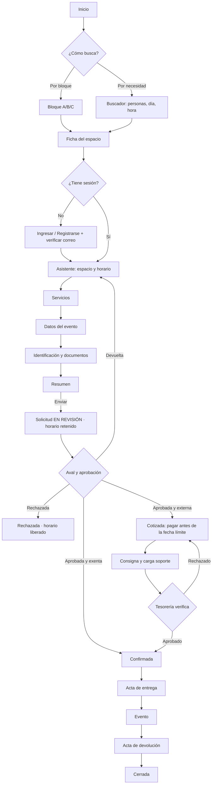

# SIRA - Frontend

> Next.js 16 (App Router) · React 19 · TypeScript · Tailwind CSS 4 · FullCalendar.
> Código en la raíz del repositorio Frontend.

## 1. La idea que guía todo: navegar como está organizado el campus

En otras universidades (por ejemplo, el módulo de reservas de UCEVA) todos los espacios están en un solo selector: para encontrar algo hay que hacer scroll por una lista enorme. SIRA organiza la búsqueda como está organizado físicamente el campus:

```
Sede (Mocoa)  →  Bloque A · Bloque B · Bloque C  →  Piso  →  Espacio (A-201)
```

Tres principios de interfaz salen de ahí:

1. **El bloque es la puerta de entrada.** La página de inicio muestra los bloques como tarjetas grandes (foto, cantidad de espacios por tipo). Dentro del bloque, el plano con la numeración oficial y los espacios agrupados por piso.
2. **La capacidad siempre está a la vista.** Cada tarjeta muestra el aforo con un ícono de personas en el mismo tamaño que el nombre. No se esconde en la ficha.
3. **El sistema ayuda a escoger bien.** Antes de elegir espacio el usuario puede decir "somos 35 personas"; las tarjetas de espacios donde no caben se atenúan, y en los que sobra mucho espacio (un auditorio de 300 para 35) aparece la sugerencia de alternativas más adecuadas.

## 2. Identidad visual

Tomada del *Manual de Identidad Visual UNIPUTUMAYO, versión 01-2025*.

| Token | Valor | Uso |
|---|---|---|
| `--color-azul` | `#18668F` | Primario: encabezado, botones principales, enlaces, foco. Contraste 6,3:1 sobre blanco (AA). |
| `--color-azul-oscuro` | `#0F4A69` | Hover, texto sobre fondos claros de marca. |
| `--color-naranja` | `#F5A51D` | Acentos, estado "retenido", insignias. **Nunca como color de texto sobre blanco** (contraste 2,0:1). Texto encima: gris oscuro `#222` (7,8:1). |
| `--color-verde` | `#80BF1F` | Estado "libre", éxito. Igual que el naranja: solo fondo o borde, con texto oscuro. ⚠️ El manual trae el HEX del verde mal (`#bf1f50`); se usa el valor RGB 128,191,31. |
| `--color-gris` | `#595957` | Texto secundario (7:1 sobre blanco). |
| `--color-gris-claro` | `#B2B6B9` | Bordes, separadores (secundario, máx. 30 %). |

- **Tipografía:** Raleway (títulos, como el logotipo) y Roboto (texto, interfaz), ambas de Google Fonts mediante `next/font`. Heavitas es solo para el logotipo y no se usa como fuente web.
- **Logo:** versión azul sobre fondo claro; en blanco sobre el azul. Mínimo 75 px de ancho. Archivos en `public/marca/`. ⚠️ Pedir a Comunicaciones los archivos originales en SVG.
- **Obligatorio en el pie:** "VIGILADA MINEDUCACIÓN".
- **El sitio actual de la universidad no es referencia de diseño**, solo de marca.

### Códigos de estado del calendario (RF-CAL-04)

El estado **nunca** se comunica solo con color (RNF-09). Cada estado tiene color, patrón y etiqueta de texto:

| Estado | Fondo | Patrón | Etiqueta |
|---|---|---|---|
| Libre | Blanco | — | (franja vacía, clicable) |
| Retenido en trámite | Naranja claro | Rayas diagonales | "En trámite" |
| Reservado | Azul | Sólido | "Ocupado" o nombre del evento público |
| Clase | Gris claro | Puntos | "Clase" |
| Mantenimiento | Gris | Cuadrícula | "Mantenimiento" |
| Festivo | Gris claro | — | "Festivo" |

## 3. Mapa de rutas

Grupos de rutas de App Router (los paréntesis no aparecen en la URL):

```
src/app/
├─ (publico)/                       sin sesión · layout con encabezado institucional
│  ├─ page.tsx                      /            Inicio: bloques + buscador por aforo + calendario de la sede
│  ├─ sedes/[sede]/bloques/[bloque]/page.tsx  /sedes/MOC/bloques/A   Plano + espacios por piso + filtros
│  ├─ espacios/[codigo]/page.tsx    /espacios/A-201  Ficha del espacio + calendario
│  ├─ buscar/page.tsx               /buscar      Búsqueda inversa (fecha, hora, asistentes)
│  ├─ servicios/page.tsx            /servicios   Catálogo complementario
│  ├─ simulador/page.tsx            /simulador   Simulador de tarifa
│  └─ ayuda/page.tsx                /ayuda       Requisitos, cancelación, contacto
├─ (auth)/
│  ├─ ingresar/  registro/  verificar-correo/  recuperar/  restablecer/
├─ (cuenta)/                        requiere sesión
│  ├─ solicitar/page.tsx            Asistente de 6 pasos
│  ├─ mis-solicitudes/page.tsx
│  └─ mis-solicitudes/[id]/page.tsx  Línea de tiempo, cotización, pago, actas
└─ (panel)/panel/                   requiere rol distinto de SOLICITANTE
   ├─ page.tsx                      Tablero
   ├─ calendario/                   Línea de tiempo de la sede (RF-CAL-10)
   ├─ aprobaciones/                 Bandeja (responsable / aprobador)
   ├─ solicitudes/  pagos/  actas/
   ├─ inventario/                   sedes · bloques · espacios · elementos · tipos
   ├─ servicios/  tarifario/
   ├─ reportes/  auditoria/  configuracion/
```

El menú lateral del panel se arma según los roles del usuario: un responsable de espacio ve Tablero, Calendario, Aprobaciones y Actas; tesorería ve Tablero, Pagos y Reportes; el auditor ve todo en solo lectura.

## 4. Pantallas por rol

### 4.1 Visitante

| Pantalla | Propósito | Contenido |
|---|---|---|
| Inicio | Entrar por bloque o por necesidad. | Selector de sede · tarjetas de Bloque A/B/C (foto, conteo de aulas, salas, laboratorios, auditorios) · buscador "¿para cuántas personas, qué día, a qué hora?" · calendario de ocupación agregada de la sede. |
| Bloque | Ver qué hay en el bloque. | Plano con la numeración · filtros por tipo y capacidad mínima · espacios agrupados por piso en tarjetas (código, nombre, tipo, **aforo**, dotación resumida, "desde $X"). |
| Ficha del espacio | Decidir. | Galería · aforo y área · dotación (elementos con cantidad) · condiciones de uso · tarifas por tipo de solicitante · calendario semanal · botón "Solicitar este espacio". |
| Búsqueda inversa | "Necesito un sitio para 60 el viernes de 2 a 6". | Resultados ordenados por ajuste de capacidad (el más cercano al aforo primero). |
| Servicios | Ver qué más se puede contratar. | Por categoría, con unidad de cobro y anticipación. |
| Simulador | Estimar el costo sin registrarse. | Aviso: "El valor definitivo se confirma en la cotización". |

### 4.2 Solicitante (externo o interno)

**Asistente de solicitud** (sección 10.2 del documento base):

| Paso | Contenido | Validación inmediata |
|---|---|---|
| 1. Espacio y horario | Calendario del espacio; selección por clic o arrastre; agregar más franjas o espacios. | Anticipación, horario de operación, aforo vs. capacidad con sugerencias. |
| 2. Servicios | Catálogo filtrado por tipo de espacio. | Anticipación de cada servicio. |
| 3. Datos del evento | Objeto, descripción, asistentes, responsable en sitio, teléfono, ¿evento público? | |
| 4. Identificación | Si es interno: "¿uso institucional o particular?" + dependencia. Documentos según tipo. | Póliza si el aforo la exige. |
| 5. Resumen | Desglose, total o "$0 · valor de referencia $X", condiciones, cancelación. | Aceptación de condiciones. |
| 6. Pago | **Solo externos**, y solo cuando la solicitud ya está aprobada (`COTIZADA`). En el MVP: datos de la cuenta, referencia y carga del soporte. | En exentas este paso **no existe**. |

El asistente **guarda borrador automáticamente** (no se pierde nada si se recarga la página) y no retiene horario hasta "Enviar solicitud".

**Mis solicitudes:** lista con estado y próxima acción ("Esperando aprobación", "Paga antes del 14/11 a las 6:00 p. m."). El detalle muestra la línea de tiempo de estados, la cotización en PDF, el pago y las actas.

### 4.3 Responsable de espacio y aprobador

- **Bandeja de aprobación:** lista priorizada por fecha del evento y tiempo en espera (resalta lo que se va a escalar). El detalle muestra la solicitud completa, el calendario del espacio alrededor de la franja pedida, los adjuntos y tres acciones: **Aprobar**, **Devolver** y **Rechazar** (las dos últimas exigen motivo). El aprobador además puede **Reclasificar como uso particular**.
- **Actas** (pensadas para celular): checklist de elementos con cantidad y estado, fotos con la cámara, novedades con valor.

### 4.4 Tesorería

- **Pagos:** pestañas "Por verificar", "Aprobados", "Rechazados", "Vencidos". Al verificar se ve el soporte junto a los datos de la orden (referencia, valor, solicitante) para comparar sin cambiar de pantalla.

### 4.5 Administrador

- **Inventario:** árbol sede → bloque → espacio a la izquierda, formulario a la derecha. Fotos con arrastrar para ordenar, portada y texto alternativo obligatorio.
- **Tarifario:** tabla por espacio × tipo de solicitante × unidad, con vigencia y acuerdo soporte.
- **Calendario:** línea de tiempo de todos los espacios de un bloque en un día (RF-CAL-10), bloqueos manuales y recurrentes, importación del horario académico con reporte de conflictos.
- **Configuración:** dominios institucionales, plazos, política de cancelación, plantillas de correo, usuarios y roles.

### 4.6 Auditor

Las mismas pantallas del panel en solo lectura, más la **Bitácora** filtrable.

## 5. Flujos principales



## 6. Estados de cada pantalla

Toda pantalla que carga datos implementa los cinco estados. No se considera terminada sin ellos:

| Estado | Regla |
|---|---|
| Cargando | Esqueletos con la forma del contenido (no un spinner en blanco). `loading.tsx` por ruta. |
| Vacío | Mensaje + acción. "Aún no hay espacios en este bloque. Crear el primero." / "Todavía no has hecho ninguna solicitud. Busca un espacio." |
| Con datos | Normal y con muchos datos: paginación en tablas, virtualización si una lista pasa de 200 filas. |
| Error | Mensaje en lenguaje del usuario (viene en `mensaje` de la API) y botón para reintentar. `error.tsx` por ruta. |
| Sin permiso | "No tienes acceso a esta sección" con enlace al inicio. Para un recurso ajeno: 404. |

## 7. Componentes que se repiten

| Componente | Dónde |
|---|---|
| `EncabezadoInstitucional`, `PieInstitucional` (con "VIGILADA MINEDUCACIÓN") | Todas las páginas públicas |
| `TarjetaBloque` | Inicio |
| `TarjetaEspacio` (código, nombre, tipo, `IndicadorAforo`, dotación, precio desde) | Bloque, búsqueda, sugerencias |
| `IndicadorAforo` (ícono + número; atenuado si no caben, advertencia si sobra demasiado) | Tarjetas, ficha, asistente |
| `CalendarioEspacio` (FullCalendar con estados, patrones y etiquetas) | Ficha, asistente, bandeja |
| `InsigniaEstado` (estado de solicitud con color + texto) | Listas, detalle |
| `LineaTiempoSolicitud` | Detalle de solicitud |
| `ResumenCotizacion` | Asistente, detalle, bandeja |
| `CargadorArchivos` (arrastrar, vista previa, tamaño máximo) | Fotos, documentos, soportes |
| `DialogoConfirmacion` (con el valor a reembolsar cuando aplica) | Toda acción destructiva |
| `EstadoVacio`, `EstadoError` | Todas las listas |

## 8. Reglas de implementación

- **Datos:** las páginas públicas son Server Components que llaman a la API desde el servidor (mejor SEO y primera carga). Lo interactivo (calendario, asistente, formularios) son Client Components.
- **Cliente HTTP:** un solo módulo `src/lib/api.ts` con la URL base, manejo del token, refresco automático ante `401` y traducción de errores.
- **Sesión:** el access token vive en memoria del cliente; el refresh en la cookie `httpOnly` que pone la API. Las rutas de `(cuenta)` y `(panel)` se protegen en el servidor.
- **Formularios:** validación inmediata en el campo, pero la que cuenta es la del servidor. Si el envío falla, **no se borra lo escrito**.
- **Textos:** los botones dicen lo que hacen y el resultado lo confirma: "Enviar solicitud" → "Solicitud enviada", nunca "Operación exitosa".
- **Formato (RNF-13):** fechas `dd/mm/aaaa`, hora de 12 h con "a. m."/"p. m.", pesos sin decimales con punto de miles (`$1.250.000`). Utilidades en `src/lib/formato.ts`, siempre en `America/Bogota`.
- **Responsivo (RNF-11):** desde 360 px. En celular el calendario pasa a vista de lista por día.
- **Accesibilidad (RNF-09):** navegación completa por teclado (el calendario incluido), foco visible con el azul institucional, `alt` en toda imagen, etiquetas en todo campo, contraste ≥ 4,5:1. Se revisa con Lighthouse y axe en cada PR que toque interfaz.
- **Impresión:** cotización, acta y comprobante se generan como PDF en el backend, tamaño carta.
